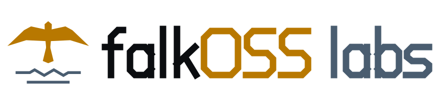

  <picture>
    <source media="(prefers-color-scheme: dark)" srcset="assets/falkoss-labs-lockup-on-dark.svg">
    
  </picture>

<b>Small free software from Falkensee.</b> 
part of <a href="https://falkoss.org">falkOSS – Falcon Lake Open Source Software</a>

**falkOSS labs** is where the smaller projects of [falkOSS](https://github.com/falkoss) live: plugins, tools, forks
and experiments that are useful on their own but don't need an organisation of their own.

### What lives here

- **Tools and plugins** – small, focused, finished rather than ambitious.
- **Forks** – when we need to carry changes to someone else's project. We send them upstream whenever we can.
- **Experiments** – ideas we try in public. Some grow, some stay small, some get archived.

Every repository says in its README what state it is in and how much care it gets. When a project outgrows labs, it
moves to an organisation of its own – GitHub keeps redirecting the old links.

### Same rules as falkOSS

- **Free licences** – everything is open source under an OSI-approved licence; forks keep their upstream licence.
- **Everything included** – one edition, every feature free; no paid tiers, nothing held back.
- **No telemetry** – nothing phones home.
- **In the open** – issues, plans, reviews and decisions happen in public.
- **Non-profit** – part of the falkOSS gUG (in formation); money goes into the software, never into profits.

### Contribute

Open an issue or a pull request in the repository you care about. For anything else:
[falkoss.org](https://falkoss.org) · [support@falkoss.org](mailto:support@falkoss.org)
